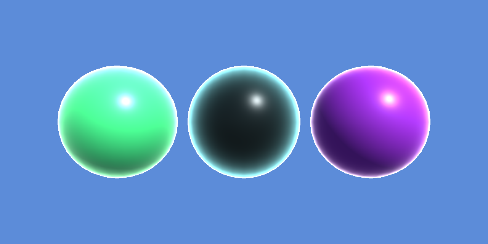
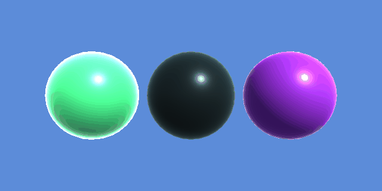
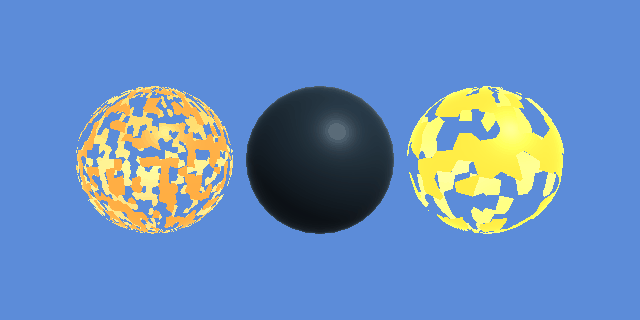

# unity-shadergraph

Custom shaders built with Unity's ShaderGraph on the Universal Render Pipeline (URP).

## Setup

- Unity 6000.4.7f1 (Unity 6, newer than the required 2022.3 LTS)
- Universal RP 17.4.0 and Shader Graph 17.4.0
- The URP asset is in `Assets/Settings/URP_Asset.asset` and is assigned under **Edit > Project Settings > Graphics** and every Quality level

## Tasks

### 0. Glow up

`Assets/Shaders/glow.shadergraph` is a URP Lit graph that makes an untextured object glow around its edges. The material is `Assets/Materials/glow.mat`.

How it works: a **Fresnel Effect** node gets brighter where the surface turns away from the camera, so it is strongest at the silhouette. Its output is multiplied by the glow color and the glow strength and sent to **Emission**, while the base color goes to **Base Color** as usual.

Properties you can change in the Inspector:

| Property | What it does |
| --- | --- |
| Base Color | Main surface color |
| Glow Color | HDR color of the edge glow |
| Glow Strength | How bright the glow is (0 turns it off) |
| Glow Power | Fresnel exponent: higher values give a thinner rim |
| Smoothness | Surface smoothness, for the specular highlight |

`glow_cyan.mat` and `glow_pink.mat` are extra presets that use the same shader. The `GlowShowcase` scene shows all three on spheres.

### 1. Pulse

`Assets/Shaders/glow_animated.shadergraph` takes the glow shader and makes the glow fade in and out. The material is `Assets/Materials/glow_animated.mat`.

How it works: the **Time** node is multiplied by the pulse frequency and by 2π, then goes through a **Sine** node, so it repeats once per second when the frequency is 1. A **Remap** node turns the sine's -1 to 1 range into 0 to 1, and a **Lerp** node uses that value to blend between the minimum and maximum glow strength. The result replaces the fixed strength from the previous task.

Properties you can change in the Inspector:

| Property | What it does |
| --- | --- |
| Base Color | Main surface color |
| Glow Color | HDR color of the edge glow |
| Min Glow Strength | Glow brightness at the dimmest point of the pulse |
| Max Glow Strength | Glow brightness at the brightest point of the pulse |
| Pulse Frequency | Pulses per second |
| Glow Power | Fresnel exponent: higher values give a thinner rim |
| Smoothness | Surface smoothness, for the specular highlight |

`glow_animated_cyan.mat` and `glow_animated_pink.mat` are extra presets with different speeds. The `GlowPulse` scene shows all three. The pulse plays in Play mode, or in the Scene view when **Always Refresh** is turned on in the effects menu.

### 2. Mr. Stark, I don't feel so good

`Assets/Shaders/disintegrate.shadergraph` makes an object break apart into fragments and then put itself back together, on a loop. The material is `Assets/Materials/disintegrate.mat`.

How it works:

- A **Voronoi** node splits the surface into cells. Its **Cells** output gives every cell one random value between 0 and 1, so each cell acts like one fragment. Fragment Scale sets the cell density.
- **Time** times the speed and 2π goes through a **Sine** and a **Remap**, which gives a threshold that moves up and down between 0 and 1.
- The cell value goes into **Alpha** and the threshold into **Alpha Clip Threshold**, so every fragment whose value is below the threshold is cut away. As the threshold rises, more fragments disappear, one by one.
- A **Step** node finds the fragments that are about to disappear (their value is just above the threshold) and lights them with the edge color, so the pieces look like they burn away. Those fragments drop their base color so the glow stays bright.
- The graph renders both faces, so through the holes you see the inside of the shell instead of nothing.

Properties you can change in the Inspector:

| Property | What it does |
| --- | --- |
| Base Color | Main surface color |
| Disintegration Speed | How many times per second the object falls apart and comes back |
| Fragment Scale | Number of fragments: higher values give smaller pieces |
| Edge Color | HDR color of the fragments that are about to disappear |
| Edge Width | How many fragments glow before they disappear |
| Smoothness | Surface smoothness, for the specular highlight |

`disintegrate_fine.mat` (small fast fragments) and `disintegrate_chunky.mat` (big fragments) are extra presets. The `Disintegrate` scene shows all three. Like the pulse, the animation plays in Play mode, or in the Scene view with **Always Refresh** turned on.

## Asset package

`unity-shadergraph.unitypackage` contains the shader graphs, the materials and the showcase scenes. To use it, import it into a URP project with **Assets > Import Package > Custom Package**, then drag `glow.mat`, `glow_animated.mat` or `disintegrate.mat` onto any 3D object.
